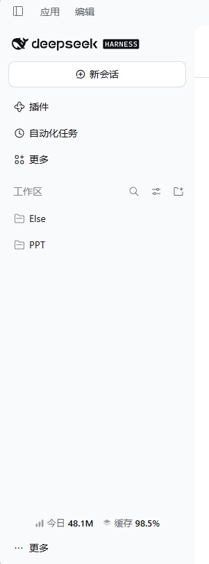
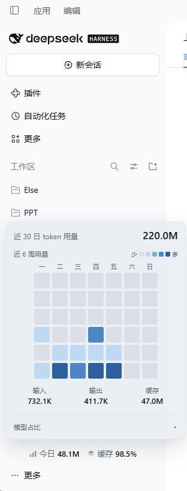

#  dsh-token-usage

一款简单美观的token用量展示的dsh插件

## 安装

可通过npm和github两种方式进行安装：

```
@orange-v-soda/dsh-token-usage          # npm
github:orange-v-soda/dsh-token-usage    # GitHub
```

## 什么时候需要？
如果您：
- 希望简单，美观的每日token用量统计，缓存比例
- 想看到近期的用量，模型占比
那么本插件或许能有帮助

## 效果

| 侧边栏 | 点开面板 |
| :---: | :---: |
|  |  |

## 技术说明

[docs/technical.md](docs/technical.md) —— 技术文档细致的说明了：数据来源、聚合算法、增量缓存策略、接口契约与渲染结构。建议交给agent阅读。

## 声明

- **适配版本**：DSH `>= 0.2.1-rc.2`
- **开源协议**：MIT
- **纯本地**：只读本机会话日志，不联网、不上传，不写入任何会话数据
